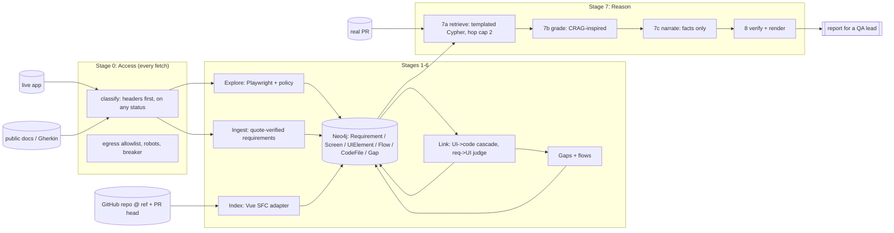

# blastradius: design document

*An intent-aware change-impact agent. It crawls a live web app, ingests its product spec, connects both to the
source code that built it in a Neo4j graph, and tells a QA lead which screens, flows and requirements a real pull
request puts at risk, and what it could not determine.*

**Status:** numbers below are from run `crawl-gate-150` (2026-10-12) unless a line says it was not run.
Evidence for the earlier reconnaissance is in [RECON.md](RECON.md); decisions are in [DECISIONS.md](DECISIONS.md);
edge cases and their final status are in [CASES.md](CASES.md).

---

## 0. Summary

**What it does.** For one target (Hoppscotch, an open-source API client) it (1) explores the running app with a
browser agent and captures screens, elements and transitions; (2) turns the public documentation into atomic,
quote-verified requirements; (3) indexes the app's frontend source into files, import/render edges, routes and i18n
keys; (4) builds a Neo4j graph across Requirements, UI and Code with a confidence and an evidence record on every
edge; (5) given a real PR, returns a blast-radius report a QA lead can act on in five minutes.

**What I chose to go deep on, and why.** The crawl is the least differentiated part; anyone can wire a browser
agent. The signal is in three places: **cross-layer linkage that carries evidence and confidence**, **absence
modelled as a recorded search rather than a missing edge**, and **a reasoner whose every claim is machine-checked
against evidence**. The code layer is deliberately shallow (frontend, file granularity) and the document says so.

**Headline results** (all on the real app, real repo, real PRs; details in sections 5 and 9):

| | |
|---|---|
| Frontend indexed | 1,273 code files loaded; 2,219 i18n keys (21 without a value); 463 render edges; 5,728 imports; 20 routes |
| Live crawl | 55 screens, 1,468 elements, 321 transitions, 150 actions, 0 WAF blocks; 280 requests stopped by the egress allowlist |
| UI -> code links | 333 of 434 named canonical elements (76.7%) have an `IMPLEMENTED_BY` edge. 1,409 edges: 1,292 `i18n_key`, 117 `llm_pick`. Median confidence 0.30. Against the source-map oracle (124 scored controls, 3 pages): linker coverage 117/124 (Wilson 95% 0.888–0.972), top-1 of covered 64/117 (0.457–0.634), hit@3 of covered 78/117 (0.577–0.746) |
| Requirements | 343 extracted, 160 kept, 341 of 343 quotes verified before later drops; 183 dropped (154 over the per-chunk cap, 19 duplicates, 6 not phrased as a user action, 2 too long, 2 quote-shape). Cost $0.6256 on claude-sonnet-5-5. 124 of those 160 have a `REALIZED_BY` edge (320 edges). Docs are 2026.5.0; the app is 2026.9.0 |
| PR #6645 | Risk HIGH. 3 direct items (2 confirmed, 1 possible), 7 indirect, 5 could-not-determine, checklist of 2. Verifier passed. Narration is the template. The checklist is the environment sidebar. The requirements table had 48 rows; the first cut of D41 listed 12 and held 36 back. A hop-0 control lists its requirement even when a shared-code route is more confident. A screen, flow, or shared-code link lists one only when the wording overlaps the change. A removal stays listed |
| Tests | 2,385 collected in 60 files. The full suite, including the live Chromium tests, passed on 2026-10-12 (about 14 minutes, exit 0; a few tests skipped). One earlier failure, the workspace-header test, was the `.env` file refilling a variable the test had unset; the test now ignores that file. Independent reviewers found 22 major (and 51 lesser) defects the builders' own tests missed; all fixed or dispositioned (section 10) |

**What it is not.** It is not validated accuracy on a population of PRs. Three open PRs are case studies. The
second target (Sylius) is a post-hoc check that proves the adapter boundary, not predictive impact.

---

## 1. System overview



Everything the system asserts is a row in **one evidence ledger** (`evidence.jsonl`). Captures carry an access
verdict, edges carry the evidence id of the observation that created them, retrieval is graded against
deterministic signals, and every sentence in the report cites ledger ids that the verifier, the trace explainer
and the offline judge all read. That single idea is what keeps "LLM proposes, graph disposes" true end to end.

---

## 2. Agent decomposition (brief item 5)

| # | Stage | Deterministic | LLM (and only here) | Why the boundary is here |
|---|---|---|---|---|
| 0 | **Access** | Headers-first classifier on any status; egress allowlist at the network layer; robots; circuit breaker | none | Silent corruption (ingesting a challenge page as the UI) is the worst failure; it must not depend on a model |
| 1 | **Explore** | DOM/a11y capture, fingerprinting, frontier, action classes, budgets | *Policy*: re-rank candidates; goal bias | "What is worth trying" is the only semantic call; everything else must be reproducible |
| 2 | **Ingest** | Page allowlist, normalisation, verbatim-quote check, polarity/edition cue checks, spec sha | Extract atomic requirements | Extraction is semantic; hallucination is caught mechanically by the quote and cue checks |
| 3 | **Index** | Clone at a ref, tree-sitter, SFC splitter, `components.d.ts` resolver, routes, i18n, file classes | none | Structure is decidable; a model would add noise and cost |
| 4 | **Link** | Text/i18n cascade with a reachability prior; BM25 candidates | Judge top-K with an explicit NONE; fallback file pick (capped 0.60) | Retrieval deterministic, judgement semantic, output schema-constrained |
| 5 | **Gaps** | Absence bookkeeping with recorded effort | goal-directed re-crawl (same explorer) | Turns "not found" from a guess into a bounded, recorded search |
| 6 | **Flows** | Shortest-path replay over observed transitions | none | Paths are structural; names come from screen titles |
| 7a | **Retrieve** | Templated Cypher, hop cap 2 + one forward hop, locale-key diff, DISTINCT counts | none | Blast radius is a graph query |
| 7b | **Grade** | Signals -> CORRECT / AMBIGUOUS / INCORRECT -> action; verdict *caps* confidence | Haiku residue judge on AMBIGUOUS only; **demote-only** | The LLM may remove confidence, never add radius |
| 7c | **Narrate** | Structured facts as JSON | Write prose; no tools | A model that only sees checked facts cannot invent impact |
| 8 | **Verify** | Cited ids exist, verb matches the lowest band, completeness, no ids/paths in the body | one regeneration | The report never asserts what the graph cannot back |

**Where the agentic part actually is.** Stages 1 and 5 are an agent in the strict sense: perceive, decide, act,
with state (visited fingerprints), goals (unresolved requirements), memory, a budget, and a recorded outcome.
Stages 2-4 and 6-8 are a pipeline, and I say so rather than dressing a chain of prompts as an agent.

**Four checkers, four jobs, deliberately independent.** The stage-4 *linker judge* generates; the stage-7b
*runtime grader* assesses retrieval quality; the stage-8 *verifier* is deterministic and consumes the grader's
verdicts; the *offline eval judge* never enters the product path and sees raw evidence only. If any two shared a
prompt, the evaluation would grade a component against its own instructions.

**Crawler choice.** Playwright with an explorer of my own rather than browser-use. I need transition-level
determinism and state fingerprints that become graph nodes; an opaque trajectory is the wrong artifact, and a
per-step LLM call is the wrong cost model. I borrowed its one good idea (an indexed interactive-element list).

---

## 3. Graph schema and how absence is modelled (brief item 6)

```
(:Requirement {id=hash(quote), text, quote, section, edition, polarity, ui_observable, doc_version, spec_sha})
(:Screen      {id, target, url_pattern, title, kind: page|modal|tab|embed, fingerprint, bundle_hash})
(:UIElement   {id, role, name, scope, owner_hint})          // canonical; APPEARS_ON each Screen
(:Flow {id, name})  (:CodeFile {path, kind})  (:I18nKey {key, en})  (:Route {pattern})
(:Gap {id, kind, status, confidence, reason, screens_searched, actions_spent, bundle_hash})

(UIElement)-[:APPEARS_ON]->(Screen)     (UIElement)-[:LEADS_TO {action, observed}]->(Screen)
(Requirement)-[:REALIZED_BY {confidence, method, evidence_id, screen_ids}]->(UIElement|Screen|Flow)
(UIElement)-[:IMPLEMENTED_BY {confidence, method, evidence_id, screen_ids}]->(CodeFile)
(CodeFile)-[:IMPORTS|RENDERS]->(CodeFile)   (CodeFile)-[:USES_KEY]->(I18nKey)
(Requirement|UIElement|Screen)-[:HAS_GAP]->(Gap)   (Gap)-[:SEARCHED]->(Screen)
```

**Absence is a node, not a missing edge.** A missing edge cannot distinguish three different truths: the feature
does not exist, we did not look, and we were not allowed to look. A `Gap` carries which of those it is and the
search effort that justifies it:

| kind | meaning | status |
|---|---|---|
| `NO_UI_EVIDENCE` | UI-observable, cloud-web requirement; nothing realizes it | `NOT_FOUND_WITHIN_BUDGET` (+ effort); `CONFIRMED_ABSENT` only on explicit negative evidence |
| `NOT_UI_TESTABLE` | NFR/API, or another edition (desktop, self-host) | `CLASSIFIED` |
| `ACCESS_RESTRICTED` | behind login/WAF/policy; **excluded from the NOT_FOUND denominator** | `SKIPPED_BY_POLICY` |
| `UNSPECIFIED_UI` / `UNMAPPED_CODE` | UI with no requirement / no code link | `OBSERVED` |

Real consequence on this target: the docs changelog stops at 2026.5.0 while the app is 2026.9.0, and several
statements are edition-gated ("only in the Desktop App"). Without `edition` and `doc_version` on the requirement,
"absence" would have measured spec drift and manufactured missing features.

**The query the schema exists to answer** (parameterised template, read transaction, hop cap 2):

```cypher
UNWIND $changed AS p MATCH (f:CodeFile {path:p, target:$t})
MATCH (imp:CodeFile)-[:IMPORTS|RENDERS*0..2]->(f)
MATCH (el:UIElement)-[im:IMPLEMENTED_BY]->(imp) MATCH (el)-[:APPEARS_ON]->(s:Screen)
WHERE size(im.screen_ids) = 0 OR s.id IN im.screen_ids        // per-screen attribution
OPTIONAL MATCH (fl:Flow)-[:STEP]->(el) OPTIONAL MATCH (r:Requirement)-[rb:REALIZED_BY]->(el)
RETURN s, el, collect(DISTINCT fl), collect(DISTINCT r), im.confidence, rb.confidence
```

The absence half joins `NO_UI_EVIDENCE` gaps whose `SEARCHED` screens are served by an impacted file: those
requirements are reported as **cannot verify**, and as **may close a gap** when the diff text matches. An
edge-only schema drops both silently.

**Why Neo4j and not a table.** The decisive operation is reachability over IMPORTS/RENDERS with per-edge confidence
and per-screen attribution; I wanted the schema to be inspectable by a human in the Neo4j browser during the demo.
Kuzu has no wheel for Python 3.14; networkx is kept only as an eval mirror.

---

## 4. UI -> code mapping, the part that took the most engineering (brief items 3, 6)

DOM text does not identify a file. The cascade, in order, first hit wins:

1. **Route**: the screen's URL pattern matches a file-based route (vite-plugin-pages); page + layout seed the
   reachability set.
2. **Reachability prior**: candidate files are restricted to the render closure of page + layout. 213 of 1,903
   distinct English values are shared by more than one key; this filter resolves most of that ambiguity.
3. **Text -> i18n key -> files**: normalised name/aria-label/placeholder/title matched to `en.json` values, then to
   files using that key, intersected with the closure. Confidence = prior 0.90 divided by the number of surviving
   files (floor 0.30), so impact still includes them but with lower confidence.
4. **Literal text** (prior 0.70 / k), **test ids** (configurable attributes; empty on this target).
5. **LLM pick** among reachable candidates, hard-capped at 0.60.
6. Otherwise `UNMAPPED_CODE` with a reason (`no_text`, `no_candidate`, `external_package`, `llm_budget`).

**Auto-import resolution** is the riskiest engineering piece: Hoppscotch uses `unplugin-vue-components`, so most
`<Tag/>` uses have no import statement. The committed `components.d.ts` is parsed as a resolver; 1,323 of 1,419
`(file, tag)` pairs resolve through it and 0 needed the namespace fallback. I report the resolved-tag rate as a
metric so the failure mode is visible rather than silent.

**Measured against an independent reference** (source-map oracle, section 8): 3 page visits (`/`, `/graphql`,
`/settings`), 21 chunks pinned by ETag, 208 elements labelled, 124 scored as distinct (file, role, name, ordinal).
The linker covers 117/124 of those (Wilson 95% 0.888–0.972). Top-1 precision among covered controls is 64/117
(0.457–0.634); hit@3 is 78/117 (0.577–0.746). By method, `i18n_key` top-1 is 42/90 and `llm_pick` top-1 is 22/27.
Top-1 is a conservative number: the oracle names the file whose template contains the element, and the linker
names the file that displays its text, so a prop-passed label counts as a miss. The 76.7% figure above is how
often a named element got some code edge, not how often that edge was the right file.

**What I cut here and why.** The scope-id (`data-v-*`) hash rung covers ~12-17% of SFCs and none under
`environments/`, the directory the primary PR touches; as product evidence it would also have made the oracle
circular. It survives only as a drift detector. The `data-testid` rung is empty on this target (kept configurable:
the PostHog check found `data-attr` in 2,576 files, a strong rung Hoppscotch lacks).

---

## 5. Reasoning over a PR (brief items 4, 7)

**Retrieval is a graph query, not a prompt.** Changed files are classified first (test, generated, lockfile,
docs, build config, global style, persisted-data schema, locale, source); locale diffs are compared structurally
(base vs head JSON, not patch text). The 2-hop closure is capped because the measured fan-out is dangerous:
from the two services PR #6645 touches, **2 hops reach 28% of the 337 `.vue` files, 3 hops 47%, unbounded 77%**.
A flat file list would tell a QA lead to retest most of the app.

**CRAG-inspired grading.** Published CRAG uses a fine-tuned evaluator and a web-search fallback; I adopt its
Correct / Ambiguous / Incorrect trigger pattern and say so.

| verdict | meaning | action |
|---|---|---|
| CORRECT | every seed mapped, >= 1 element at >= 0.5 per seed (or copy-only with locale evidence), breadth < 25% at 2 hops, no hub on the path | ACCEPT |
| AMBIGUOUS | evidence present but broad, via a hub, or low confidence | NARROW (symbol filter, *downgrade never delete*), EXPAND (one forward hop, locale route), PROBE, or residue judge |
| INCORRECT | no usable evidence for a UI-directory seed | moved to "could not determine" + `UNMAPPED_CHANGE` gap |

The grader is a pure function of graph signals. The model may only **demote**, and may nominate a missing item
only through a probe that itself yields an evidence row. Every added item must carry a deterministic edge. The
verdict **caps** confidence and never raises it. At most 2 rounds, at most 6 judge calls per PR.

**Why not GraphRAG communities.** Impact queries are path questions; community summaries blur file-level precision
and add a hallucination surface. (A networkx Leiden run returning 839 singletons is a default-resolution artifact
and is not evidence.) Retrieval *is* graph-grounded and evidence-cited, which is graph RAG in the retrieval sense.

**The report** (fixed section order, `docs/REPORT_SPEC.md`): risk and one-sentence confidence; a checklist of
actions in the product's own words; directly changed UI; indirect through shared code (capped, grouped by spec
section); global change; stored data with a migration checklist; requirements at risk; and **what we could not
determine and who should look**, with the same visual weight as findings. File paths and ids appear only in the
appendix. A deterministic lint enforces this; a hedge-verb table ties wording to confidence band.

A direct item is hop 0 in the changed file (or a copy of its wording), and either the link confidence is at least
0.5 or the string lives in one file. A string shared by more than three files below 0.5 is not listed as a control.
Wording the PR adds and the live app does not show yet is one "could not determine" row, not a line on every screen.
The checklist is confirmed and likely direct actions, plus at most two likely indirect ones. Possible and unknown
are not actions.

On PR #6645 that produces: risk HIGH, touching the Home page and the menu popup on it; re-test "Environment Quick
Peek" and "Edit"; five things not determined, including the new labels "Edit current value" and "environments
editor". A requirement is listed when a changed file implements its control (any hop-0 route, even if a
shared-code route on that control is more confident), or when a screen, flow, or shared-code link shares a word
with the change. A requirement whose only controls this PR removes stays listed. The last regeneration listed 12
rows and held 36 back; that 12 was not all environment editing (a few were collection and AI-script rows kept by
a hop-0 control or a flow step). The word check is a stem overlap, so the table can still carry a loosely
related row. A QA lead should re-test the checklist first.

---

## 6. Confidence handling under ambiguity (brief item 7)

| situation | what happens |
|---|---|
| PRD feature not found in the UI | `NO_UI_EVIDENCE` gap with the effort spent; `SPEC_MAY_BE_STALE` / `CONFIG_DEPENDENT` reason; never reported as "missing" while access or edition is unresolved |
| Feature behind login / WAF / policy | `ACCESS_RESTRICTED`, excluded from the not-found denominator |
| Changed file maps to no UI | `UNMAPPED_CHANGE` + "could not determine"; a human is asked, with the file and the neighbours checked |
| Changed file is a hub (`@hoppscotch/data`: 283 importers) | forced AMBIGUOUS, symbol narrowing, residue judge, then a "Global change" bucket instead of fifty screens |
| Two LLM samples disagree | link dropped to `needs_review.json`; never promoted |
| PR path missing at the indexed snapshot (new file, stale base) | flagged; attached via the head overlay to its importers; stale-base note on the report |

**Representation.** Every edge carries `{confidence, method, evidence_id}`. Method priors are fixed and published
(route 0.95, i18n key 0.90, test id 0.90, literal 0.70, LLM pick <= 0.60, judged requirement link <= 0.80 scaled by
agreement). Path confidence = product of edges x 0.8 per hop; alternative paths combine by noisy-OR for confidence
only, never for counts. Human bands: Confirmed >= 0.8, Likely 0.5-0.8, Possible 0.25-0.5, Unknown < 0.25. Observed
facts (the crawl) are 1.0 and tagged `observed`, so "seen" and "inferred" never blur. These are **uncalibrated
priors**, stated as such; I do not print 0.87-style precision.

**When it stops and asks.** A changed UI-directory file maps to nothing; a high-severity item rests only on
Possible links; two samples disagree; a gap's effort is below the coverage floor; a path no longer exists at the
indexed snapshot. These become `needs_review.json` and a report section, not a silent guess.

---

## 7. Access, WAF and observability (user-raised)

**Stance.** The system never attempts to evade, defeat, or stealth-bypass WAFs, bot management, or CAPTCHAs.
Protected apps are reached **cooperatively** (owner allowlist, a secret-header skip rule, a service token, staging
without a WAF) or **offline** (a recorded session the owner supplies). When blocked it fails loudly, records a gap
and says what the owner must enable.

**Detection is the product feature.** The classifier reads headers first on any status (`cf-mitigated`; AWS WAF's
`x-amzn-waf-action` arrives as 202/405), has a separate Cloudflare block rule, and treats vendor *presence*
(`cf-ray`, `server: cloudflare`, `x-vercel-id`) as never a block. That last rule is not theory: docs.hoppscotch.io
and demo.usememos.com both carry `cf-ray` and serve real pages, and Hoppscotch's real shell is 5,219 bytes, so
body size is never a signal either. Independent review found two false-positive classes in my first version
(ordinary page copy containing "press & hold" or "just a moment"); both are fixed with regression tests.

**Amazon-class UI** is modelled with recorded fixtures and a pattern list (hover mega-menu, lazy carousels,
infinite scroll, delivery-location modal, ad iframes). It is not crawled: there is no owner cooperation, and with
no repo the code layer cannot exist anyway. The legitimate deployment is a customer's own WAF-fronted app.

**Observability** is small on purpose: one run directory with `trace.jsonl` (start and end events, OTel-shaped, so
a crash leaves the open span), `ledger.jsonl` (tokens, USD, cache hit, avoided USD), `failures.jsonl` (a closed
enum of codes, each with an owning stage and a user action), and `evidence.jsonl`. `blastradius doctor` is a
no-spend preflight; `blastradius trace tree` reconstructs a run. The LLM cache key never includes the run id, and a
cache hit still emits a span, so cost is never understated. Redaction is allowlist-minded with a canary test.

---

## 8. Evaluation: how do we know a run was right? (brief item 8)

If the system ran 100 times on the same input, which runs were correct?

1. **Invariants decide most of it, with no judge.** Schema valid; every cited evidence id exists in the ledger;
   every claim's verb matches the lowest band among its cited edges; no ids or paths in the body; counts are
   DISTINCT. A run violating any is wrong regardless of content.
2. **Determinism by construction.** Traversal is deterministic; the only variance is hunk classification and
   narration. Models reject sampling parameters on the current generation, so determinism comes from the
   content-addressed cache, schema-constrained output, and k-sample agreement. Cross-process determinism is tested
   under different hash seeds (and caught a real bug, section 10).
3. **An independent link metric.** Hoppscotch publishes full source maps, so exact DOM-element -> `.vue` ground
   truth is obtainable from production: walk the Vue vnode tree, locate each `type.setup` text in exactly one
   chunk, majority-vote source-map segments. Used test-only; an import-lint forbids the linker from importing it.
   On this run: harvest of `/`, `/graphql` and `/settings` (3 visits, 21 chunks). 208 observed elements were
   labelled (208/208, Wilson 95% 0.982–1.0). Scoring uses 124 distinct controls that also exist on indexed main.
   Linker coverage 117/124 (0.888–0.972). Top-1 of covered 64/117 (0.457–0.634). Hit@3 of covered 78/117
   (0.577–0.746). Top-1 of all scored, counting an unlinked control as wrong, is 64/124 (0.429–0.602). `i18n_key`
   top-1 is 42/90; `llm_pick` top-1 is 22/27 (n = 27, interval 0.633–0.918). This exists *because this target
   publishes maps*; the fallback for others is a hand-labelled gold set, which was not built.
4. **An offline judge, kept honest.** Evidence-only, binary items, quote string-checked, k = 3 majority; 20
   deterministic seeded corruptions give an *upper bound* on the true-negative rate. Reported with Wilson 95%
   intervals; the same-vendor-family caveat is stated (a gateway to put the judge on another family was tried and is not
   integrated, D42). Not run for this submission (it spends model calls). No TNR.
5. **Stability.** Re-run stages 4-7 N = 5 times with the cache bypassed: affected-set Jaccard and per-item
   agreement; items under 60% agreement are demoted. Not run for this submission. N = 100 is discussed as cost
   arithmetic only.
6. **Ablation.** A (deterministic traversal) vs A + grader on the three PRs, thresholds pre-registered in
   `eval/thresholds.json` before running. Three PRs are case studies, never validated accuracy.

The synthetic-PR recall check reuses the links that built the graph, so it measures *consistency*, and the report
labels it circular. On this run, with hop cap 2 and link confidence at least 0.8: screen recall 142/142
(Wilson 95% 0.9737–1.0), nontrivial files 80/80 (0.9542–1.0), flows 458/458 (0.9917–1.0). That is consistency
with the graph, not proof the links are right.

Invariants on the three regenerated reports (after claim ids include the screen, and the headline requirement
count is the distinct rows in the table): all three pass. An earlier draft failed `ids_unique` (the same sentence
on two screens hashed to one claim id) and `counts_distinct` (the headline counted requirements attached to
screens, and the table listed more).

---

## 9. Scope decisions: what I cut, what I went deep on, and why (brief item 9)

| Went deep | Why |
|---|---|
| Linkage with evidence + confidence; absence with effort; verified claims | These are the judgement calls the brief is about |
| Safety and determinism of everything that touches untrusted input | PR text, DOM text and spec text are prompt-injection surfaces; all are wrapped and schema-bounded |
| Independent review of my own build | 22 majors and 51 lesser findings; see section 10 |

| Cut or scoped | Why | Where it would go |
|---|---|---|
| Code layer is frontend, file granularity | No function-level call graph, no backend routes | next week, item 1 |
| One target built live; Sylius is a post-hoc slice | A second live target costs more than it earns; every candidate's PRs are already merged, so only Hoppscotch has the pre-merge case | recon in RECON.md |
| Authenticated crawl | Account creation is off-limits for an agent; a login-gated crawl needs a human-made session and can mutate the owner's project | next week, item 2 |
| GraphRAG communities, text-to-Cypher, embeddings | Path queries; injection and truncation risk; BM25 + judge is enough at this corpus size | revisit if recall@20 < 0.8 |
| Annotated screenshots, human write-back, LLM flow naming | Lowest value per hour | |
| Mobile viewport, non-English locales, SSR targets | Documented limitation: CSR only, one viewport, `en` | |
| TraceImport, Web Bot Auth, PPR, OTLP export | Designed with evidence, not built | RECON.md, DECISIONS.md |
| LLM gateway (Bifrost) and a judge from another model family | Tried as a gateway so the agents and the LLM-as-judge are not tied to one provider; not integrated: all calls use `llm.LLM` against the Anthropic API, so the judge is same-family and its numbers carry that caveat | D42; `llm.py` is the seam |

**Why Hoppscotch** (and not Memos, Saleor, Home Assistant, PostHog): the whole product is usable without login, it
has a real procedural spec (a 520 KB `llms-full.txt`), 2,198 i18n keys, a committed auto-import table, published
source maps, and three open PRs with fork heads (the pre-merge use case). PostHog was evaluated at the user's
request: strong code-side evidence, but guests reach only login/signup, so the live-crawl premise fails.

---

## 10. What the build taught me (honest findings)

I had every module independently reviewed by an engineer who had not written it, with reproduction scripts.
They found **22 major, 40 minor and 11 nit defects (73)** that the builders' own test suites passed, including:

- an egress allowlist bypassable through any redirect hop on an allowed origin;
- a blocked WebSocket that deadlocked the whole crawl;
- a "Send only to the echo URL" gate evaluated once at screen creation instead of at click time;
- a symlink in a checkout that made the indexer read files outside the repo;
- a polarity flag that could be flipped to `must_not_exist` with no textual cue;
- a graph prune guard that let a partial crawl wipe the linker's output;
- same-named controls on different pages merged into one element, over-reporting impact.

I found one myself that no single module's tests could: **the code index differed between processes** because
collapsed edges kept whichever import was encountered first and Python randomises set order per process. The
builder's determinism test ran in one process. A cross-process regression test now fails on the old code (4
distinct outputs across 6 hash seeds; now 1). The lesson I would defend: *test determinism across processes, and
test the guard (a test that cannot fail on the bug is not a test).*

---

## 11. What I would do with another week (brief item 10)

1. **A function-level code graph and backend route mapping** (OpenAPI / GraphQL operations), so a change inside a
   shared service resolves to the symbol that changed and to the API call a screen makes, replacing the 2-hop file
   closure's blunt over-approximation. *Reasoning:* the measured weakness is file-level breadth (28% of the app at
   2 hops); this is the highest-value precision gain.
2. **Authenticated crawl with seeded accounts and a read-only action class**, retiring `ACCESS_RESTRICTED` for
   login-gated features (Teams, Workspaces) and unlocking PostHog-class targets (strong code-side evidence:
   `data-attr` in 2,576 files, public source maps with `sourcesContent`, `commit_sha` in the HTML).
3. **CI mode**: post the report on the PR, and learn from reviewer corrections written back as
   `judge: human, confidence 1.0` links, with a held-out co-change replay over ~20 merged PRs to finally measure
   accuracy on a population instead of three case studies.

---

## Appendix

- [DECISIONS.md](DECISIONS.md): the decision log, including D36–D40 from the live report
- [CASES.md](CASES.md): 77 edge cases, each with a final status (handled, documented, deferred, or not handled)
- [RECON.md](RECON.md): the evidence, labelled verified / measured / recalled / unverified
- [REPORT_SPEC.md](REPORT_SPEC.md): the report contract
- [ARCHITECTURE.md](ARCHITECTURE.md): module contracts
- [sample-report-pr-6645.md](sample-report-pr-6645.md): the generated report for PR #6645 (risk HIGH, checklist of two actions). The HTML twin is [sample-report-pr-6645.html](sample-report-pr-6645.html)
